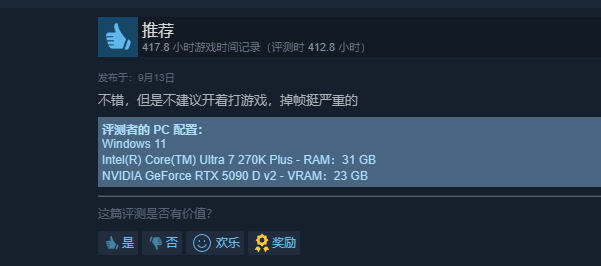

项目下载：https://code.danieluu.top/WuwaTappoNative/

鸣潮十月底的时候推出了他们的BongoCat正版授权Tappo项目。其实出来之前的时候，我就隐隐约约担心，这个项目会不会有优化上的问题。因为我特意看了一眼Steam上的评论区，结果瞥见：



哎呀我滴妈，被富哥电脑吓哭，

结果一看BongoCat用的U3d做开发，桌宠用U3d吗，这集真神了。完全不在意用户性能了说是，畏惧了。

后面10月底官方出来了，用的是Rust后端+Tauri前端。那肯定比起本家的，还算是属于“混沌中立”了，但是作为一个浏览器项目，多多少少令人有点难受，说到底这还是一个桌宠而已。当然他们应该是考虑到要适配Macos整多平台，所以还算是能理解把。可是这样一个项目在我的电脑上，又占内存又占CPU还占GPU。然后我发给我i9十三代的朋友玩，然后他和抱怨这玩意会让他打PUBG变卡。这东西本身也要一直挂机还要手动开箱子，忍不了了！AI时代，大重构计划，开整！

于是乎我决定走极致轻量化路线，前端直接GDI绘图，后端用C#，光是内存就比本家少用太多了，直接省掉了浏览器的开销，同样是一屋子联机玩家在房间里，我能比官方的700M压到100m以内的水平。cpu也保持在常规2%，峰值10-15%左右的水平。

那既然是非官方项目，当然要给大家整点花活儿啦！


各种辅助功能以及设置中心皮肤


支持本地试用暂未拥有的角色


自由地旋转放大移动你的头饰


实时显示你的按键


以及作为音游玩家的私心（可以切换为鸣潮键位的）

以及...


```md

- ✅ 支持原版全部在线内容与联机
- ✅ 支持国服与国际服（Global）切换与官方登录继承
- ✅ 支持国际服浏览器验证登录（邮箱 / X / Google 已验证可用，其他方式未验证需自测）
- ✅ 支持简体中文 / English / 日本語界面（英/日为预览版，部分内容仍为中文）
- ✅ 支持国服手机号 + 短信验证码登录（库洛通行证）
- ✅ 支持自定义所有皮肤（他人房间中仅显示你实际拥有的皮肤，但本地可设置为任意皮肤）
- ✅ 支持发送任意表情（无视拥有状态、无视角色限制，他人可见）
- ✅ 支持头饰位置、自由缩放和旋转微调，按头饰独立保存
- ✅ 支持主题色自动生成整套配色、平滑取色器和图片自动取色
- ✅ 支持操作台背景图上传、透明度/模糊调节、主题预设保存与自动轮换
- ✅ 支持主桌宠/远程角色独立底栏配色；键盘、音游、鸣潮和手柄统一跟随
- ✅ 支持主桌宠与远程角色底栏分别隐藏，可用单键或双键快捷键切换
- ✅ 支持面板最大化、八方向边缘缩放，并记住面板大小与最大化状态
- ✅ 支持 F8 多屏切换：默认位置成员、仅主角、全部成员三种策略，跨分辨率按比例映射
- ✅ 支持联机桌宠 Ctrl 多选、Ctrl+A 全选、整组拖动贴边和点击空白退出选中
- ✅ 支持在设置页查看服务器当前下发的全部公告（含已读状态）
- ✅ 支持刷 Key 数量（一键 +10000），支持在不足1000的时候自动补齐
- ✅ 支持自动升阶合成与一键全部升阶
- ✅ 支持正式版 / 测试版更新通道
- ✅ 支持自动领取宝箱
- ✅ 支持自动表情、自动敲击和游戏模式规则
- ✅ 支持快捷键和设置项搜索
- ✅ 支持手柄协议扩展，仅在未检测到 XInput 手柄时兼容 PS / Switch 等 DirectInput 手柄
- ✅ 支持显示当前键盘/手柄键位，并跟随主题配色
- ✅ 音游模式支持 4K / 5K / 6K，每个模式分别保存键位；可设置空格和 ; ' , . / 等标点键
- ✅ 支持一键继承官方登录状态
- ✅ 支持主播模式 OBS 采集窗口（自定义背景色/透明背景）
- ✅ 支持联机角色自动避让、横向/纵向排列与重置排序
- ✅ 支持单独显示/隐藏联机成员，并按成员保存设置
- 更多优化功能等你发现......

```

总之希望大家喜欢！

希望能够给我一个star，这对我非常重要qwq

[DanielToyama/WuwaTappoNative: BetterWuwaTappo,Easier,Faster,Lighter,i18n 更好的鸣潮桌宠，支持官方全功能，更方便，更快，更轻。](https://github.com/DanielToyama/WuwaTappoNative)

以及哔哩哔哩项目上给我一键三连哦https://www.bilibili.com/video/BV1nRxk6dERS/
